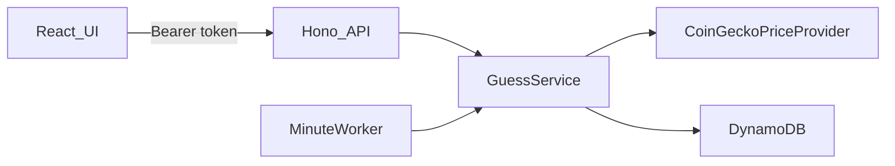

# BTC Prediction Arena

A small game where a player guesses whether the Bitcoin price will be higher or lower after one minute. The server stores the entry price, waits at least 60 seconds, and changes the score only when a later trade actually moves the price.

This is a small MVP. It is meant to be easy to run, test, and explain.

## Core features

- Anonymous players start at score 0. Scores can go negative.
- The latest BTC/USD price is shown with the trade time.
- A player can guess UP or DOWN, and only one guess can be open.
- The server captures the entry price and the deadline. The browser cannot send them.
- A guess settles only after 60 seconds and only when the price is different.
- A correct guess adds 1 point. An incorrect guess subtracts 1 point.
- The score and the open guess survive a refresh and a closed browser.
- The last 10 settled guesses are shown.

There is no registration, leaderboard, or real-money play.

## Live demo

There is no public URL yet. AWS credentials are not available in this workspace, and nothing was deployed. See [Deployment](#deployment).

## Technology stack

- React, TypeScript, Vite, TanStack Query, Tailwind CSS, Lucide
- Vitest and React Testing Library
- Hono on Node.js for the local API, and the same app on AWS Lambda
- Zod contracts in `@arena/shared`
- DynamoDB, API Gateway HTTP API, EventBridge, AWS CDK
- CoinGecko public BTC/USD price. Coinbase Exchange is still supported with `PRICE_PROVIDER=coinbase`.

## Architecture



The open browser polls `GET /api/me` every few seconds while a guess is active. That call tries to settle the guess. A one-minute EventBridge worker calls the same `GuessService.settleDue` method for players who closed the tab. EventBridge is only minute-level, so the open app is the fast path.

## Game rules

The rule is not "settle exactly at 60 seconds."

1. `POST /api/guesses` accepts only `{ "direction": "UP" }` or `{ "direction": "DOWN" }`.
2. The server reads a fresh BTC/USD price and stores it as the entry price.
3. `eligibleAt` is the server time plus 60 seconds.
4. Before `eligibleAt`, the guess stays pending.
5. After `eligibleAt`, settlement needs a quote whose trade time is at or after the deadline.
6. If that price is greater than the entry price, UP is correct and DOWN is incorrect.
7. If it is lower, DOWN is correct and UP is incorrect.
8. If it is equal, the guess stays pending and is checked again later.
9. If the price service times out, returns a bad payload, or the quote is older than 2 minutes, the guess stays pending. No score change is invented.
10. The score changes in one conditional DynamoDB update. A retry cannot apply it twice.

Prices are decimal strings compared with integers at 8 decimal places. Binary floating point is not used for the result.

### Limits of the market data

The price comes from CoinGecko's public Bitcoin/USD quote, including the time CoinGecko last updated it. This is an aggregated market price, not one exchange's last trade. Coinbase Exchange was the first choice, but that host cannot be reached from this network. Entry and settlement still use one source. If CoinGecko has not published a newer price after the deadline, the guess stays open even though 60 seconds have passed. The UI countdown is only a hint. A wrong laptop clock does not change the result, because the deadline and the score are stored on the server. Responses include `serverTime`, and the countdown uses that offset.

## Getting started

Prerequisites: Node.js 22 and pnpm. Docker is not required. Local DynamoDB is an in-process [dynalite](https://github.com/mhart/dynalite) server.

```bash
pnpm install
pnpm dev
```

The API listens on `http://127.0.0.1:3001`. The web app listens on `http://localhost:5173` and proxies `/api`. Copy [.env.example](.env.example) to `.env` only if you want to override a default.

Useful variables:

| Variable | Default | Purpose |
| --- | --- | --- |
| `PORT` | `3001` | API port |
| `PRICE_PROVIDER` | `coingecko` | `coingecko`, `coinbase`, or local `mock` |
| `QUOTE_MAX_AGE_MS` | `120000` | Reject older quotes |
| `ALLOWED_ORIGIN` | `http://localhost:5173` | Browser origin allowed to call the API |
| `VITE_API_URL` | empty | Set this for a production frontend build |

### Local demo with a fake price

Production never uses a fake price. For a local demo, start the API with the mock provider so you can force the next trade:

```powershell
$env:PRICE_PROVIDER="mock"
pnpm --filter @arena/api dev
```

```bash
PRICE_PROVIDER=mock pnpm --filter @arena/api dev
```

Submit a guess in the UI. After the countdown, if you want a specific result:

```bash
curl -X POST http://127.0.0.1:3001/api/dev/quote -H "content-type: application/json" -d "{\"price\":\"71000.00\"}"
```

That route exists only when `PRICE_PROVIDER=mock` and `NODE_ENV` is not `production`. The 60-second wait is still real. The unit tests are the fast way to show the timer rules without waiting.

## Running tests

```bash
pnpm test
pnpm typecheck
pnpm lint
pnpm build
```

API tests cover the scoring rules, the 60-second boundary, an unchanged price, a provider failure, a rejected second guess, a race between two submits, and a repeated settlement. DynamoDB conditional writes are tested against dynalite. Frontend tests use a fake `fetch`. No test calls the live Bitcoin API.

## Deployment

Deploy only after you approve the AWS cost. This stack is small and on-demand, but it is still a real account change. The table removal policy is `DESTROY`, so deleting the stack deletes scores.

1. Build the Lambda bundle:

   ```bash
   pnpm --filter @arena/api build
   ```

2. From `infrastructure`, bootstrap once per account and region, then deploy. Set the frontend origin before the deploy so the API does not stay on `http://localhost:5173`.

   ```powershell
   $env:CDK_DEFAULT_REGION="eu-central-1"
   $env:ALLOWED_ORIGIN="https://your-frontend-origin"
   pnpm --filter @arena/infra exec cdk bootstrap
   pnpm --filter @arena/infra exec cdk deploy -c allowedOrigin=https://your-frontend-origin
   ```

3. The output `BtcPredictionArena.ApiUrl` is the API base URL. It looks like `https://abc123.execute-api.eu-central-1.amazonaws.com`. There is no stage path to add.
4. Build the frontend with that origin:

   ```powershell
   $env:VITE_API_URL="https://abc123.execute-api.eu-central-1.amazonaws.com"
   pnpm --filter @arena/web build
   ```

5. Host `apps/web/dist` on any static host, such as an S3 bucket behind CloudFront. Set `ALLOWED_ORIGIN` to that site and deploy the API again if the origin changed.

### Post-deploy checklist

- `GET {ApiUrl}/api/health` returns `status: ok`.
- `GET {ApiUrl}/api/price` returns a CoinGecko BTC/USD price. If it returns 503, the function cannot reach CoinGecko or the quote is stale.
- Open the frontend, refresh, and confirm the score is still there.
- Submit one guess and confirm a second guess returns 409.
- Wait past 60 seconds. The score changes only after the price moves.
- Confirm the dev quote route is absent. Production sets `NODE_ENV=production` and `PRICE_PROVIDER=coingecko`.

The Lambda bundle includes the AWS SDK, so the function does not depend on the SDK copy inside the Lambda runtime.

## Technical decisions

- One service owns the rules. HTTP handlers, the poll, and the worker all call it.
- DynamoDB conditional updates protect the single active guess and the one-time score change.
- The browser token is random. The database stores only its SHA-256 hash.
- The server caches the CoinGecko price for 20 seconds so the page can refresh without hitting the public rate limit. Settlement will not reuse a quote from before the deadline.

## Known limitations

- Coinbase Exchange cannot be reached from this network, so the live price comes from CoinGecko. Set `PRICE_PROVIDER=coinbase` only where that host answers. Provider failures still return 503 and do not invent a score.
- The AWS stack has not been deployed from this workspace, so this README has no live URL yet.
- The worker runs once a minute and handles 25 due guesses per run. A closed tab can settle up to about a minute late, and a large backlog takes several minutes.
- The due-guess index is eventually consistent. The player's own `GET /api/me` uses a consistent read, so the open app is not affected.
- Anonymous `localStorage` is not an account. Clearing site data starts a new player. Anyone with the token can play as that player.
- History trimming is a second write after the score update. If trimming fails, the score is still correct and the history is only a little longer until a later settle.
- The UI was checked with component tests and an API smoke test. It was not clicked through in a browser here.

## Future improvements

- A hosted frontend in the same CDK app, once a domain and an AWS account are chosen.
- Alarms on Coinbase errors and on settlement failures.
- A shorter demo clock only behind an obvious local flag, if a demo should not wait 60 seconds.
- Real authentication if scores need to move across devices.

## Project map

- [apps/web](apps/web) — dashboard
- [apps/api](apps/api) — game rules, HTTP API, DynamoDB
- [packages/shared](packages/shared) — Zod contracts
- [infrastructure](infrastructure) — CDK stack
