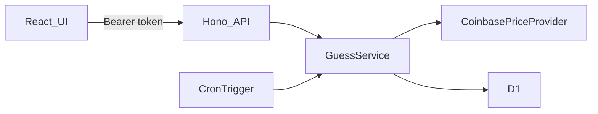

# BTC Prediction Arena

A small game where a player guesses whether the Bitcoin price will be higher or lower after one minute. The server stores the entry price, waits at least 60 seconds, and changes the score only when a later trade actually moves the price.

This is a small MVP. It is meant to be easy to run, test, and explain.

## Core features

- Anonymous players start at score 0. Scores can go negative.
- The latest BTC/USD price is shown with the trade time.
- A player can guess UP or DOWN, and only one guess can be open.
- The server captures the entry price and the deadline. The browser cannot send them.
- A guess settles only after 60 seconds and only when the price is different.
- A correct guess adds 1 point. An incorrect guess subtracts 1 point.
- The score and the open guess survive a refresh and a closed browser.
- The last 10 settled guesses are shown.

There is no registration, leaderboard, or real-money play.

## Live demo

The API is deployed at `https://epilot-btc-arena-api.btc-arena-demo-2026.workers.dev`. The dashboard is not on Pages yet. See [Deployment](#deployment).

## Technology stack

- React, TypeScript, Vite, TanStack Query, Tailwind CSS, Lucide
- Vitest and React Testing Library
- Hono on Cloudflare Workers. The same routes still run on Node for tests.
- Zod contracts in `@arena/shared`
- Cloudflare D1 for scores, Pages for the dashboard, and a one-minute Cron Trigger
- Coinbase Exchange public BTC-USD ticker. The quote is the last trade and the time of that trade.

## Architecture



The open browser polls `GET /api/me` every few seconds while a guess is active. That call tries to settle the guess. A one-minute Cloudflare Cron Trigger calls the same `GuessService.settleDue` method for players who closed the tab. Cron is only minute-level, so the open app is the fast path.

## Game rules

The rule is not "settle exactly at 60 seconds."

1. `POST /api/guesses` accepts only `{ "direction": "UP" }` or `{ "direction": "DOWN" }`.
2. The server reads a fresh BTC/USD price and stores it as the entry price.
3. `eligibleAt` is the server time plus 60 seconds.
4. Before `eligibleAt`, the guess stays pending.
5. After `eligibleAt`, settlement needs a quote whose trade time is at or after the deadline.
6. If that price is greater than the entry price, UP is correct and DOWN is incorrect.
7. If it is lower, DOWN is correct and UP is incorrect.
8. If it is equal, the guess stays pending and is checked again later.
9. If the price service times out, returns a bad payload, or the trade is older than 15 seconds, the guess stays pending. No score change is invented.
10. The score changes in one conditional SQL statement. A retry cannot apply it twice.

Prices are decimal strings compared with integers at 8 decimal places. Binary floating point is not used for the result.

### Limits of the market data

The price is the latest public Coinbase Exchange BTC-USD trade, including the time of that trade. Entry and settlement use that same source. If no newer trade has printed after the deadline, the guess stays open even though 60 seconds have passed. The UI countdown is only a hint. A wrong laptop clock does not change the result, because the deadline and the score are stored on the server. Responses include `serverTime`, and the countdown uses that offset.

## Getting started

Prerequisites: Node.js 22 and pnpm. Docker and AWS are not required. Local scores live in Wrangler's D1 database.

```bash
pnpm install
pnpm db:migrate
pnpm dev
```

The Worker listens on `http://127.0.0.1:3001`. The web app listens on `http://localhost:5173` and proxies `/api`. Copy [.env.example](.env.example) to `.env` only if you want to override the Node mock server. The Worker reads `apps/api/wrangler.jsonc`.

Useful variables:

| Variable | Default | Purpose |
| --- | --- | --- |
| `PORT` | `3001` | API port |
| `PRICE_PROVIDER` | `coinbase` | `coinbase`, `coingecko`, `mexc`, or local `mock` |
| `QUOTE_MAX_AGE_MS` | `15000` | Reject older Coinbase trades |
| `ALLOWED_ORIGIN` | `http://localhost:5173` | Browser origin allowed to call the API |
| `VITE_API_URL` | empty | Set this for a production frontend build |

### Local demo with a fake price

Production never uses a fake price. For a local demo, start the API with the mock provider so you can force the next trade:

```powershell
$env:PRICE_PROVIDER="mock"
pnpm --filter @arena/api dev:node
```

```bash
PRICE_PROVIDER=mock pnpm --filter @arena/api dev:node
```

Submit a guess in the UI. After the countdown, if you want a specific result:

```bash
curl -X POST http://127.0.0.1:3001/api/dev/quote -H "content-type: application/json" -d "{\"price\":\"71000.00\"}"
```

That route exists only when `PRICE_PROVIDER=mock` and `NODE_ENV` is not `production`. The 60-second wait is still real. The unit tests are the fast way to show the timer rules without waiting.

## Running tests

```bash
pnpm test
pnpm typecheck
pnpm lint
pnpm build
```

API tests cover the scoring rules, the 60-second boundary, an unchanged price, a provider failure, a rejected second guess, a race between two submits, and a repeated settlement. D1 conditional writes are tested with Wrangler's local D1. The older DynamoDB repository is still tested against dynalite. Frontend tests use a fake `fetch`. No test calls the live Bitcoin API.

Check the Worker bundle without deploying:

```bash
pnpm --filter @arena/api bundle:worker
```

## Deployment

The free path is Cloudflare Workers, D1, Cron Triggers, and Pages. No AWS account and no credit card. Do this from the repository root in PowerShell after `pnpm install`. Create a free Cloudflare account first. Nothing below has been run against a real account from this workspace.

1. Log in:

   ```powershell
   pnpm --filter @arena/api exec wrangler login
   ```

2. Create the database and copy the `database_id` it prints:

   ```powershell
   pnpm --filter @arena/api exec wrangler d1 create btc-arena-db
   ```

3. Paste that id over the placeholder in `apps/api/wrangler.jsonc` (`d1_databases[0].database_id`).

4. Apply the migration to the remote database:

   ```powershell
   pnpm --filter @arena/api db:migrate:remote
   ```

5. Deploy the API. The first deploy allows `http://localhost:5173`, which is already in `wrangler.jsonc`.

   ```powershell
   pnpm deploy:api
   ```

   The deployed Worker is `https://epilot-btc-arena-api.btc-arena-demo-2026.workers.dev`.

6. Check the API before building the page:

   ```powershell
   curl.exe https://epilot-btc-arena-api.btc-arena-demo-2026.workers.dev/api/health
   curl.exe https://epilot-btc-arena-api.btc-arena-demo-2026.workers.dev/api/price
   ```

   Health should return `status: ok`. Price should return the latest Coinbase BTC-USD trade, with `source` set to `coinbase-exchange:BTC-USD`. A 503 means Coinbase did not answer or the trade was older than 15 seconds.

7. Build the dashboard with that Worker origin and no trailing slash:

   ```powershell
   $env:VITE_API_URL="https://epilot-btc-arena-api.btc-arena-demo-2026.workers.dev"
   pnpm --filter @arena/web build
   ```

8. Deploy the static files to Pages:

   ```powershell
   pnpm deploy:web
   ```

   Wrangler prints the Pages URL, like `https://epilot-btc-arena.pages.dev`.

9. Put that exact origin into `ALLOWED_ORIGIN` in `apps/api/wrangler.jsonc` and deploy the API again. Do not rebuild the frontend unless the Worker URL changed.

   ```powershell
   pnpm deploy:api
   ```

10. Open the Pages URL. Submit one guess, refresh, and confirm the score and the open guess are still there. A second guess is rejected. After 60 seconds the score changes only when the price moved. `POST /api/dev/quote` must stay absent.

The `infrastructure` folder is an earlier AWS sketch. It is not part of this deploy.

## Technical decisions

- One service owns the rules. HTTP handlers, the poll, and the cron handler all call it.
- One SQL statement deletes the active guess, adds the score, and inserts the result. A retry cannot apply it twice.
- The browser token is random. The database stores only its SHA-256 hash.
- The server caches the Coinbase BTC-USD trade for 4 seconds so the page can refresh without hammering the public endpoint. Settlement will not reuse a trade from before the deadline.

## Known limitations

- The Worker reads the Coinbase Exchange BTC-USD ticker. A direct probe from this Cloudflare account returned HTTP 200 with the last trade price and its timestamp. CoinGecko still returns HTTP 429 from Workers, and MEXC's public trade is BTC/USDT, so neither is the production source. Provider failures still return 503 and do not invent a score. The public error does not include the upstream status. That status is written to the Worker log as `price_provider_failed`.
- The API is deployed. The Pages site is not, so there is no dashboard URL yet.
- The free Cloudflare plan is enough for this game: Workers, D1, Pages, and a minute cron. Cron handles 25 due guesses per run. A closed tab can settle up to about a minute late.
- D1's free quota is 5 million rows read and 100,000 rows written per day. That is plenty for a review, and a popular public link could hit the write cap.
- Anonymous `localStorage` is not an account. Clearing site data starts a new player. Anyone with the token can play as that player.
- History trimming is a second write after the score update. If trimming fails, the score is still correct and the history is only a little longer until a later settle.
- The UI was checked with component tests and an API smoke test. It was not clicked through in a browser here.

## Future improvements

- Alarms on price failures and on settlement failures.
- A shorter demo clock only behind an obvious local flag, if a demo should not wait 60 seconds.
- Real authentication if scores need to move across devices.

## Project map

- [apps/web](apps/web) — dashboard
- [apps/api](apps/api) — game rules, HTTP API, D1
- [packages/shared](packages/shared) — Zod contracts
- [infrastructure](infrastructure) — earlier AWS sketch, not used for the free deploy
